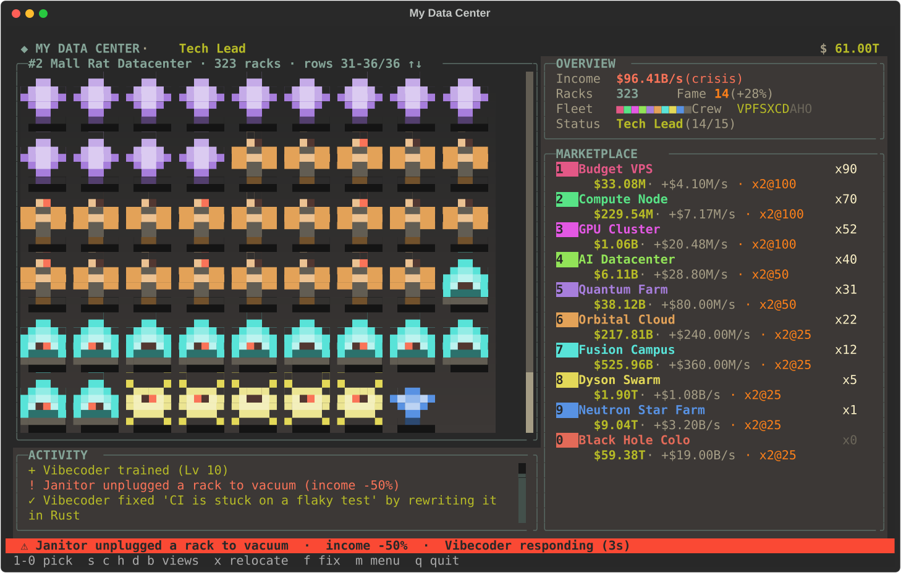
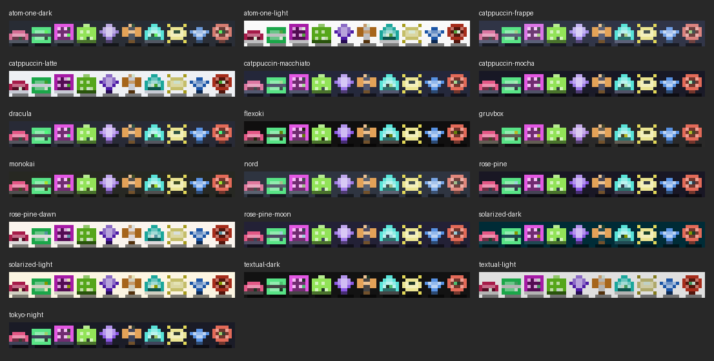

> **Inspired by [fourtysevencode/My-Data-Center](https://github.com/fourtysevencode/My-Data-Center)**, an idle tycoon you play over SSH. This is an independent rewrite for the local terminal; see [Credits](#credits).

# My Data Center

A pixel-art idle tycoon for your terminal. Buy servers, hire Vibecoders, survive crises, and relocate to ever-bigger data centers, from a budget VPS to a black hole colocation. Built to sit in a tmux pane while you wait on something else.



## Install

```
pipx install data-center-tui        # once it is on PyPI (or: pip install data-center-tui)
data-center-tui
```

From source:

```
git clone https://github.com/yusuf0279/data-center-tui
cd data-center-tui
pip install .
data-center-tui                      # or: python -m data_center_tui
```

Needs Python 3.10 or newer and a terminal with colour; 100×30 or larger looks best (80×24 works, with a smaller hall). It plays fine inside tmux and uses the keyboard only.

```
data-center-tui --no-online          # never contact the leaderboard server
data-center-tui --save my.json       # use a different save file
```

## Controls

| Key | Action |
|---|---|
| `1`-`9`, `0` | Pick an item in the open card (`0` is the 10th): buy a server, install a chip, or hire/train crew |
| `s` `c` `h` `d` `b` | Open the **s**ervers, **c**hips, crew (**h**ire), **d**ata centers or leaderboard (**b**oard) card |
| `,` / `.` | Scroll the open card when it has more rows than fit |
| `↑` `↓` `PgUp` `PgDn` `Home` `End` | Scroll the data hall |
| `x` | **Relocate** to the next data center (when your newest one reaches its target) |
| `[` / `]` | Visit the older / newer data center (or press `d`, then `1`-`6`) |
| `f` | Fix the current crisis yourself |
| `a` | Crew **a**utopilot on/off |
| `n` | Give the data center you are looking at your own **n**ame |
| `m` or `Esc` | The **m**enu: join or leave the leaderboard, change your name, rename a data center, autopilot, change theme, save and quit |
| `j` | **J**oin or leave the online leaderboard (also in the menu) |
| `ctrl+p` | Command palette, including **Change theme** |
| `q` | Save and quit |

## How it plays

- **Ten server tiers**, each with its own pixel sprite and colour: Budget VPS, Compute Node, GPU Cluster, AI Datacenter, Quantum Farm, Orbital Cloud, Fusion Campus, Dyson Swarm, Neutron Star Farm, Black Hole Colo. Cheap tiers pay back in about 30 seconds, the biggest in about 40 minutes, so each tier has its moment. Every extra copy costs a little more than the last (+7% on the cheapest up to +13% on the biggest).
- **Milestones.** Owning 25, 50, 100, 200, 300, 400 ... of a tier doubles that tier's income, and the shop shows the next one (`x2@25`).
- **Chip upgrades.** Twenty levels per tier (five chip families, four editions each), every level doubling that tier's income and costing 4x the last. Named with puns on some very familiar GPUs and CPUs ("Radeoff", "Rizzen", "Thread-Shred", "H-100 (a kidney)", "Bee-200 (melts)", "Ultra Max"...).
- **On-call crew.** Ten roles, from Vibecoder up to Founder Mode CEO, one **specialist per tier**. Train them to level 10 and they unlock perks: at Lv2 they **auto-buy their tier's cheap servers**, at Lv4 they **double that tier's income**, at Lv6 they **auto-buy its cheap chips**, at Lv8 they double it again. They also fix crises (bigger crises need more senior people), and every level adds +5% income. "Cheap" means a purchase costing at most 1/50 of a second of your income, so autopilot handles the small repetitive buying and can never use up the money you are saving for big purchases. `a` pauses it if you want to buy everything yourself.
- **Random crises.** Power cuts, flaky CI, an intern pushing to main on a Friday: they cut your income until fixed, by you (`f`) or by your crew.
- **Relocate, forever.** Reach $10 quadrillion in your newest data center and you can relocate to the next one (Garage in Palo Alto, Abandoned Mall in Ohio, Decommissioned Missile Silo, ... and on into Parallel Universes). You **start from scratch** there: money, servers, chips and crew all reset. The old data center is **decommissioned**: you can visit it (`d`, or `[` and `]`) and look around, with the lights off and everything washed out, but you can't buy anything there and it earns nothing. Your newest data center keeps earning while you look. Each new data center has bigger numbers and a target 1000x higher, and takes a little longer than the last. There is no last level.
- **Fame and status.** Every relocation earns **Fame** (more if you waited past the target): each point is +2% income in every data center, forever. Fame also climbs your status ladder: Nobody, Intern, Junior Dev, Senior Dev, Tech Lead, Engineering Manager, Director, VP of Engineering, CTO, Tech CEO, Tech Billionaire, Tech Overlord, and then Tech Overlord II, III, ... without end.
- **Names.** Every data center can be given your own name (`n`, or the menu), up to 24 plain characters; leave it blank for the default.
- **Scrollable data hall.** All your racks are drawn, cheapest tier first, with a scrollbar; it follows the newest racks until you scroll.
- **Offline earnings.** While the game is closed the data center you were in earns **75%** of its normal income, with no time limit.

### Themes

Panels, text and the hall follow your Textual theme (`ctrl+p`, then Change theme; it starts on gruvbox and remembers your choice). Each server type keeps the **same colour in every theme**, so you can always tell them apart:



### Tmux friendly

The screen only repaints when something changed. If the game runs in a tmux pane that isn't the active one, it keeps playing in the background but redraws only every 20 seconds, because every repaint of a background pane makes tmux flick your real cursor over to it.

## Online leaderboard (optional)

On first launch the game asks whether you want to join. If you do, it asks for a name and sends only that name, your Fame and your number of data centers to `data-center.openexplorer.xyz` (the code is in [`server/`](server/)). You can join, leave or change your name at any time from the menu (`m`); it is not a one-time question. It is an honour-system board. Everything the game sends and stores is listed in [PRIVACY.md](PRIVACY.md), and `--no-online` (or `DC_ONLINE=0`) switches every online feature off.

## Saves

Every data center's money, servers, chips and crew, plus your Fame, names and theme, are saved to `~/.local/share/dc-tui/save.json` (or `$XDG_DATA_HOME/dc-tui/save.json`) every second and on quit. Set `DC_SAVE=/path/to/file.json` or use `--save` for a different file. Older saves are converted automatically.

## Development

```
pip install -e .
python -m unittest discover -s tests                         # the game (about 45 s)
python -m unittest discover -s server -p test_server.py      # the leaderboard server
```

`data_center_tui/game.py` is the whole game, `server/` is the leaderboard server (see [`server/README.md`](server/README.md)), `tests/` holds the tests. The VS Code extension (`vscode/`) and browser extension (`browser/`) are not usable yet: they need a web version of the game that has not been rebuilt on the current rules.

## Credits

The idea, the "buy servers and watch the money roll in" loop and the first six tiers' income figures come from [My Data Center](https://github.com/fourtysevencode/My-Data-Center) by fourtysevencode. That project runs as an SSH server with its own accounts. The prices, price scaling, milestones, chips, crew, crises and everything after the first version are this repository's own.

The reset-and-Fame loop and the milestone doublings are inspired by mobile idle tycoons such as [Cash, Inc.](https://apps.apple.com/us/app/cash-inc-fame-fortune-game/id1270598321) and AdVenture Capitalist. The numbers here are tuned with a simulated player and are not copied from any of them.

This repository is a from-scratch rewrite in [Textual](https://textual.textualize.io/). It shares no source code with the original, whose repository has no license file.

## License

[MIT](LICENSE)
